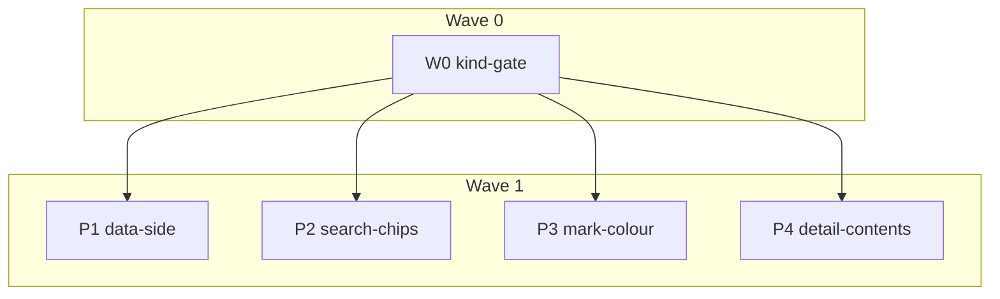

# Plan: admit the experimental `settings` kind

## Status
- State:   review
- Tier:    high
- Tier-grammar: 5
- Updated: 2026-11-06
- Next:    human review of the PR; it lands after a grim release that reads the kind (0.16.0)

Resolves [grimoire-rs/grimoire#271](https://github.com/grimoire-rs/grimoire/issues/271)
(follow-up F-2 of grim's `plan_settings_artifact_kind.md`).
Source of truth (read-only): grim's settings contract as merged in
[grimoire-rs/grimoire#318](https://github.com/grimoire-rs/grimoire/pull/318)
(head `ef2f133`, merged as `c5e3824`, same tree),
`.agents/adr/adr_settings_artifact_kind.md` (Accepted 2026-11-04),
`docs/src/content/docs/settings.md`, `docs/src/content/docs/package-index.md`,
`src/oci/settings.rs`, `src/oci/artifact_kind.rs`, `src/fetch.rs`,
`src/export/family.rs`, `src/lock/grimoire_lock.rs`,
`src/catalog/search_match.rs`, and `grim schema --kind settings`. Precedent in
this repo: `e54eb85` (feat: admit the experimental hook kind).

## Classification

- Scope: small (1–3 days). Reversibility: two-way. An enum literal is appended
  to every kind list; no schema, layout or golden changes.
- Tier: high (auto, confident: label `enhancement`, ~20 files over four areas;
  no lower band fits).
- Overlays: architect=inline (grim's accepted ADR is the design), research=skip
  (ADR plus precedent commit), adversary=off at plan time (the code-diff adversary
  runs in `/hex-review`).
- Branch: `hex/settings-kind` from `main` at `b28bf47`, rebuilt on 2026-11-06
  onto `main` at `b964d11` (the dependencies feature). Worktree
  `/home/mherwig/dev/grimoire-rs/indexer-wt-settings-kind`. Pipeline worktrees go
  under that worktree's `.agents/worktrees/` (gitignored; eslint and vitest skip it).

## Facts from grim (verified, cited at `ef2f133`)

| Fact | Value | Source |
|---|---|---|
| Wire name | `settings` (plural on the wire; `setting` is not a kind) | `src/oci/artifact_kind.rs:134`; `package-index.md:288` lists it as an index `kind`, "experimental since grim 0.16.0" |
| Kind order | `ArtifactKind::ALL` is skill, rule, agent, bundle, mcp, hook, settings; settings sorts after hook everywhere grim lists kinds, `grim describe`'s `requires` included | `src/oci/artifact_kind.rs:77,116` |
| Gate | `[options.experimental] settings`; `grim fetch` and `grim describe` are not gated | `src/config/declaration.rs:262`; `src/fetch.rs:627-637` has no flag check |
| Layer | one JSON document, `application/vnd.grimoire.settings.v1+json`, pretty-printed, sorted keys, at most 64 KiB. Top-level keys: a required `description`, the optional descriptive keys (`summary`, `keywords`, `license`, `repository`, `deprecated`, `replaced-by`, `authors`, `vendor`, `homepage`, `documentation`), and one table per harness, 13 of them (`amp`, `antigravity`, `claude`, `codex`, `copilot`, `cursor`, `droid`, `gemini`, `kilo`, `kiro`, `opencode`, `qoder`, `warp`). Any other key is refused at build. `requires` is split off at build and never reaches the layer | `src/oci/settings.rs:56-68,109-138`; `grim schema --kind settings` (`required: ["description"]`, `additionalProperties: false`); `settings.md` § The layer, § Top-level keys |
| `grim fetch` | `content` is the layer verbatim ("The layer IS the document") and is not re-validated on read; no `--path`, no `--vendor` | `src/fetch.rs:627-637` |
| Media types | the manifest's config is the OCI empty config on the wire; `application/vnd.grimoire.settings.config.v1+json` exists only so the read path is total. The indexer reads no media type, so neither reaches it | `src/oci/artifact_kind.rs:173,192`; the ADR |
| Bundles, `requires` | a bundle member and a `requires` entry may be settings | `src/oci/bundle.rs:8`, `src/oci/requires_decl.rs:7` |
| Marketplace | `grim export marketplace` omits settings members (`NoFormatSurface`, every family), as it omits hooks; `marketplace.lock` carries them as `[[settings]]` (shared `RawLock`) | `src/export/family.rs:161-162`; `src/lock/grimoire_lock.rs:63-71,101-106` |
| Announce | `grim publish --announce` writes `kind: "settings"` into the pointer it proposes | `src/command/publish.rs:1584`, `src/catalog/index_announce.rs:44-46` |
| Search kind word | stem one trailing `s` off **both** the token and each kind name: `settings`, `setting`, `SETTINGS` filter; `settingss` is a text term | `src/catalog/search_match.rs:394-408,527-539` |
| Not read by the indexer | the install report fields (`settings_changes`, `pieces`, `element`) and `kind_read` (a field of grim's own `$GRIM_HOME/catalog` cache for direct registry browses). The indexer runs only `describe`, `fetch`, `export marketplace` and `--version`, and its records always carry a kind | `src/catalog/registry_catalog.rs:257` |
| grim 0.15.1 | does not know the kind: `kind_from_manifest` resolves an unknown artifact type, config media type or annotation to no kind, so `describe` reports `kind: null`, and enrich writes no contents for the package | grim `v0.15.1`: `src/oci/annotations.rs:377` (test `kind_from_manifest_unknown_annotation_value_is_none`), `src/oci/artifact_kind.rs:149` |
| Release | settings ships in grim 0.16.0 (unreleased; the latest release is 0.15.1); hook shipped in 0.15.0 | `settings.md:9`, `Cargo.toml:12` |

## Decisions taken autonomously (question → research → decision)

The owner is not prompted (goal-loop rule); each row records what was asked, what
was checked, and what was decided.

| # | Question | Research | Decision |
|---|---|---|---|
| D1 | Does settings get a contents tab? Hook got none. | Hook's `fetch` content is `hook.toml` text, neither markdown nor JSON, so `e54eb85` left it out. Settings' content is the JSON layer (`fetch.rs:627-637`), at most 64 KiB, under `BLOB_CAP` (1 MiB). The renderer already shows any non-`members` `contents.json` as pretty JSON (the MCP branch, `PackageDetail.astro:135-139`). The issue lists `src/enrich/index.ts:225`, the `JSON_KINDS` line. A settings layer cannot carry a `members` key: a non-harness top-level table is refused at build (`settings.md` § Top-level keys). | Add `settings` to `JSON_KINDS`. The Contents tab then shows what the package writes into harness config, which is what a reader deciding to install needs. Hook stays out, pinned by a test. |
| D2 | The JSON branch is labelled for MCP ("Descriptor cut at 2 KiB", `data-grim-preview="mcp"`). | The page cap acts only on the `tags` and `downloads` sections (`pagecap.ts:39`), so the preview name is a marker, not a cap input. `Section` and `SECTION_NOUN` are internal (`bounds.ts:124-133`). | A settings page uses its own preview section `settings`, noun "settings document", command `grim fetch <ref>`, and the notice "Settings document cut at 2 KiB". MCP pages keep their exact markup. |
| D3 | Do settings members belong in the marketplace kind lists (`MEMBER_KINDS`, `LOCK_KINDS`)? | grim's lock writes `[[settings]]` rows in `marketplace.lock`; the export omits them, exactly as for hooks, and `hook` is in both lists. | Mirror hook: add `settings` to both. The gate then requires a settings member to be an indexed package, and the plugin page lists it. |
| D4 | Add a settings package to `test/fixtures/dev` or `test/renderer/fixture`, as `e54eb85` did for hook? | `test/data/prechange.test.ts` byte-compares `compileIndex` over `test/fixtures/dev` and the `all.json`/`stats.json`/`dist` digests over `test/renderer/fixture` against `test/data/golden/pre_plane_c0cd6bd/`. Regenerating that golden is a human Principle 9 decision and runs the base code, which rejects `settings`. The golden post-dates the hook fixtures, which is why `e54eb85` could add them. | Never touch either fixture. Coverage comes from a dedicated compile fixture (`test/data/fixtures/settings-kind/`), the floor fixture (`test/renderer/fixture-floor/floor.ts`, consumed only by `detail-bounds` and `pagecap` tests), synthesized catalogs (`index-page.test.ts`) and in-memory tests. No golden changes. |
| D5 | Add `settings` to `test/conformance/seed.mjs` `KINDS`? | The seed feeds the conformance tree grim keeps at `GRIM_REF` (`v0.15.0`); `hook` was there from the tree's first commit `d0e48c5`. A new kind reshuffles all 300 round-robin records, and the plane format is kind-agnostic. Re-checked 2026-11-06 against grim's merged contract: the tree at `GRIM_REF` still has no settings record, and `npm run conformance:check` diffs a fresh build against that tree, so a seed change here alone turns the check red. | Leave the seed alone. The regeneration is grim-side work after a grim release that ships the kind, paired with a `GRIM_REF` bump here; proposed as a follow-up issue. |
| D6 | Mark glyph. `KindMark.tsx` copies the VS Code extension's `KIND_ICONS`, which has no `settings` entry yet. | Candidates in `@vscode/codicons` 0.0.45 (the pinned devDependency): `settings` (sliders, 16 grid), `settings-gear` and `gear` (cog). The extension already uses `$(settings-gear)` for its own "Open Settings" command (`vscode/package.json:113`). Kind marks elsewhere match the kind name where a codicon exists (`agent`, `mcp`). | Codicon `settings` (the sliders), box measured from its path (about `[2, 2, 12]`). Reported to the meta-orchestrator so the extension's `KIND_ICONS` adopts the same glyph. |
| D7 | Colour. Existing hues: plugin 10°, agent 30°, hook 88°, rule 168°, mcp 216°, skill 255°, bundle 335°; the muted gray is the unknown-kind fallback. | Largest free gaps are 88–168° and 255–335°. A gray would read as "unknown kind"; cyan (~190°) sits 24° from both rule and mcp. Contrast computed with the WCAG formula. | Purple, hue ~285°: light `#933fae` (5.89:1 on the white card, 5.45:1 on the page background), dark `#d494e6` (7.14:1 on the dark card `#201f26`). Both clear AA 4.5 for the 11.5px badge. Re-measured in round 2 for the review note "close to skill": by CIEDE2000 settings and skill are the palette's nearest pair (9.8 light, 11.0 dark; the next are 14.7 and 14.5), by OKLab ΔE the purple is 8.1 from skill, past the palette's own nearest pair (7.4) and past the best cyan's 7.1 from rule. The two metrics disagree and a badge always carries its kind word and mark, so the purple stands; re-spacing the whole palette is the owner's call. |
| D8 | Search kind word: `"settings".endsWith("s")` → `setting`, which is not a kind, so adding the word to `KINDS` alone leaves `settings` a text term. | grim strips one `s` from both sides (`search_match.rs:394-408`) and tests `settings`, `setting`, `SETTINGS` and `settingss`. | Mirror grim's rule exactly; every existing kind keeps its singular and plural spellings. |
| D9 | Does admitting settings need a grim version constant or a `grim-polyfill` marker? | `grim-compat-markers.md`: no compat shims; a feature constant only for a CLI-surface need. Validation and compile never spawn grim. Enrich of a settings ref on a pre-0.16 grim fails per package through the existing failure path. `e54eb85` added no gate for hook. | None. No `MINIMUM_GRIM_VERSION` change, no marker. |
| D10 | Experimental banner on settings pages? | grim's ADR defers index presentation to follow-up work and gives no wording (`adr_settings_artifact_kind.md:900`). `e54eb85` added no banner for hooks, which run code. | None. Plain list addition, like hook. |
| D11 | Default site `description` and `tagline` (`src/config.ts`) | `e54eb85` added "hooks" to both. No test or golden pins either string (renderer goldens use the fixture's own config). | Add "settings" to both strings, after hooks. |
| D12 | Chip order position | `KNOWN_KINDS` is the admitted kinds in the gate's order (`KINDS` in `metadata.ts`), then the render-only `plugin`. That order puts `mcp` before `bundle`, where `ArtifactKind::ALL` puts `bundle` first; it predates this kind and every index's chips follow it, so it is left alone. grim sorts settings after hook. | `…, "hook", "settings", "plugin"`. |
| D13 | `CHANGELOG.md` | git-cliff rewrites the whole file at `task release:prepare` (`cliff.toml:3-8`). | Not edited. The commit subject `feat: admit the experimental settings kind` is the entry. |
| D14 | A record's `requires` (from `main`'s dependencies feature) keeps only the kinds in `REQUIRES_KINDS`, which had no `settings`. | grim declares a `requires` entry of any kind, settings included (`src/oci/requires_decl.rs:7`), and sorts them in `ArtifactKind::ALL` order. `boundRequires` drops an entry whose kind is not listed. | Append `settings` to `REQUIRES_KINDS` in `src/emit/records.ts`, after `hook`, so the list reads in grim's order. A test pins every grim kind and refuses the singular `setting`. |
| D15 | Show a settings dependency in the dev fixture, which D4 keeps free of settings packages? | `test/data/prechange.test.ts` drops `requires` from the dev `all.json` before it compares (`ADDED_KEYS`), so a `requires` entry is outside the golden; a whole settings package is not. | Add one settings entry to the `requires` of the dev fixture's `enterprise-compliance-policy-pack`, after its hook entry, and name settings in `test/fixtures/dev/README.md`. No package is added; the golden is untouched. |
| D16 | Test settings documents had only harness tables; a real layer always carries `description`. | `grim schema --kind settings` requires `description` and refuses unknown keys; grim build accepted the TOML form of each test document. | Every test document carries a `description` beside its harness tables, keys sorted as grim writes them. The floor document is 2,000 deny entries, about 62 KB, under grim's 64 KiB layer cap; the cut-boundary documents in `bounds.test.ts` were re-sized for the extra key. |
| D17 | How does a reader learn that a settings page needs a newer grim? | `grim-compat-markers.md`: no version gate for a payload difference. grim 0.15.1 reports the kind as `null`, so enrich writes no contents and the page renders from metadata alone. | No `MINIMUM_GRIM_VERSION` change and no marker. `docs/reference/cli.md` states that the Contents tab of a settings package needs `enrich` with grim 0.16.0 or newer. |
| D18 | The Contents panel took the member-list branch for any kind whose `contents.json` holds `members` (review finding S-3, a UI-misrepresentation class), and `grim fetch` returns a layer unvalidated. | grim refuses a `members` key in a settings document at build, but a registry can serve one; a `members` that is not an array also failed the build. Only a bundle's document is a member list. | `bundleMembers` (`src/renderer/astro/lib/catalog.ts`) reads `members` for the bundle kind alone, keeps only object entries and string fields, and replaces the `as` cast on the page. The floor's settings document carries a stray `members` key to pin it on a real build. |
| D19 | Which planning and review records stay on the branch? | `main` keeps plans under `.agents/plans/` (`b2e7d70`, `2fdda04`) and holds no review record. | Keep this plan. The review record is not kept; its outcomes are in the schedule log below. |
| D20 | Review (security, High): JSON that parses can still fail the whole site build: a top level that is not an object, an own `__proto__` key at any depth, or deep nesting. Bundles could already do this; a settings document allows any key at any depth. | Astro refuses a data entry that is not an object; its store serialiser refuses `__proto__`; deep nesting overflows the stack. The restore path made the same parse-only check. | `buildableJson` (`src/enrich/sidecar.ts`): an object at the top, at most 64 levels, no `__proto__` key, applied by `writeContents` and `writeSidecarFiles`. Its own commit, ahead of the kind, since it fixes bundles too. |
| D21 | Review (spec, Warn): a `marketplace.lock` with `[[settings]]` rows needs grim 0.16.0 (0.15.1's lock schema refuses unknown tables). Add a version gate? | `grim-compat-markers.md` reserves a feature constant for the rare approved case and states "no compat shims" as standing policy. Only a grim that reads the kind writes such a row, and CI's `ci.grimVersion` defaults to `latest`. | No gate. `docs/reference/cli.md` names the requirement and the effect of an older grim (the export fails; `enrich` keeps the previous one and warns). A gate is proposed as a follow-up issue for the owner. |
| D22 | Review findings left for follow-up issues (re-judged in round 2) | Each is pre-existing for every kind or shared with one, and none is settings-only: a pointer's metadata kind differing from the registry's (the pointer's kind is authoritative for every kind; flagging a mismatch would be a new feature, for every kind); content globs also matching `enrich/marketplace/export/**` (every kind); members a plugin page lists that grim's export omits (rule and hook members too, since the page lists the lock's declared members); registry markdown (README, changelog, contents) whose front matter does not parse, which fails the build as the JSON shapes of D20 did (every kind); a committed `contents.json` that predates `buildableJson`, which restore leaves in place and the site build loads (bundle and mcp only, it failed the build before this branch too, and a guard at the loader is renderer work); a JSON preview re-serialised from parsed data, so a number a double cannot hold (an integer past 2^53) shows rounded (shared with the MCP descriptor, whose preview C-010 keeps byte-identical); the `mcp`/`bundle` chip order (D12). The dark letter tile is D23; the settings hue is D7. | Not changed here; each is written up as a proposed issue. |
| D23 | Review (CSS, High, every kind; re-judged in round 2): the letter on a logo tile is `--grim-color-on-accent`, white in both schemes, 1.88:1 to 3.02:1 on the dark scheme's tiles, under WCAG 1.4.3's 4.5. This branch adds the settings tile. The proposal was a new `--grim-color-on-kind` token. | Census (`grep -rn on-accent src`): two readers, `.card-logo-fallback` and `.tile.letter`, both on a kind or muted ground; nothing paints it on the accent. A new token would leave `on-accent` a public token nobody reads, and a consumer's override of it would silently stop reaching the tiles, which the token contract counts as a rename. Every ground is tuned as text on the card, and contrast is symmetric. | `--grim-color-on-accent` keeps white in light and becomes `#201f26`, the dark card's value, in dark: 5.40:1 to 8.71:1 on every dark tile. A literal, not `var(--grim-color-card)`: the cross-model delta review showed a translucent card override (`transparent`) would then erase every letter, and the ink pairs with the kind grounds, not with the card. CSS-TOK-05 (a SHOULD) asks for a derivation where a value is derived; this one is chosen against the grounds, and the commit says why. A test computes the ratio on every ground the tile rules paint, in both schemes, and pins the ink as opaque under a transparent card. Its own `fix(renderer)` commit, ahead of the settings mark. |
| D24 | Cross-model pass (round 2; codex, `gpt-6.1-sol`, read-only sandbox, no approvals) | Run 1 ran at reasoning effort `none` with no file access: the bundled bwrap cannot set up its network namespace on this host, so every read failed. Run 2 embedded the touched sources and grim's contract excerpts and ran at effort `high`. | R5 (High, the dark settings tile) is D23. R7 (Warn, the `settingss` assertion passed with no record holding the word) is fixed. R1, R2, R3, R4 (High) and R6 (Warn) are pre-existing or shared with other kinds (D22). Run 1's F-1 (Warn, chip order) is D12. |

## Component contracts

Kind lists that change (every copy; no module owns a canonical list):
`src/validate/core/metadata.ts:13`, `src/data/index.ts:14,17`,
`src/enrich/index.ts:225`, `src/enrich/marketplace.ts:25`,
`src/validate/core/marketplace.ts:17`, `src/renderer/astro/lib/search.ts:85`,
`src/renderer/astro/components/Catalog.tsx:44`,
`src/renderer/astro/components/KindMark.tsx` (`KIND_MARKS`),
`src/renderer/astro/layouts/Base.astro:2061-2133`,
`src/renderer/astro/styles/tokens.css:58,192`, test copies
`test/renderer/index-page.test.ts:16`, `test/renderer/marketplace.test.ts:243`,
and, since the rebase onto the dependencies feature, `REQUIRES_KINDS` in
`src/emit/records.ts` (D14).
Not changed: `test/conformance/seed.mjs:14` (D5), `src/state/retention.ts:40`
(an unrelated `KINDS`).

- **C-001 Admission gate.** `KINDS` in `src/validate/core/metadata.ts` is
  `["skill", "rule", "agent", "mcp", "bundle", "hook", "settings"]` (appended).
  `validateMetadata(doc({kind: "settings"}), …)` is `ok: true`; `kind: "setting"`,
  `"plugin"` and `1` are rejected with a reason containing `kind`, and the reason
  for a wrong string lists `…, hook, settings`.
- **C-002 Compile.** `KINDS` in `src/data/index.ts` contains `settings`;
  `PackageKind` is `… | "hook" | "settings"`. `compileIndex` over a root holding
  one `kind: "settings"` pointer writes an `all.json` whose record carries
  `kind: "settings"`. A pointer with an unknown kind still throws as today.
- **C-003 Enrich contents.** `JSON_KINDS` in `src/enrich/index.ts` is
  `{"bundle", "mcp", "settings"}`; the doc comment above it names the settings
  document. When `grim describe` reports `kind: "settings"` and `grim fetch`
  returns a `content` that parses as JSON and is at most `BLOB_CAP` bytes,
  enrich writes `contents.json` (bytes unchanged) and the sidecar reports
  `hasContents: true`. Content that does not parse, or exceeds `BLOB_CAP`, writes
  nothing and reports `hasContents: false`. For `kind: "hook"` enrich writes no
  contents file, whatever `fetch` returns.
- **C-004 Marketplace enrich members.** `MEMBER_KINDS` in
  `src/enrich/marketplace.ts` is `["skill", "rule", "agent", "mcp", "hook", "settings"]`.
  A `marketplace.lock` `[[settings]]` row with `name`, `plugin` and `pinned`
  becomes the member `{kind: "settings", name, ref: <bare repo of pinned>}` of its
  plugin in `meta.json`; a row carrying `bundle`/`bundles` collapses to the bundle,
  once per plugin, as for every other kind.
- **C-005 Marketplace gate.** `LOCK_KINDS` in `src/validate/core/marketplace.ts`
  is `["skill", "rule", "agent", "mcp", "hook", "settings"]`. `lockMembers` reads
  `[[settings]]` tables: a pinned registry row → `{type: "registry"}` member, a
  `path` row → `{type: "path"}`, a bundle row → the bundle repo, a non-array
  `settings` key or a non-table row → `{type: "invalid"}` naming `settings`.
- **C-006 Search kind word.** `parseQuery` in `src/renderer/astro/lib/search.ts`
  maps a lowercased token to a kind when the token, with one trailing `s`
  removed, equals a kind name with one trailing `s` removed. `KINDS` adds
  `settings`. `settings`, `setting` and `SETTINGS` filter to the settings kind
  and leave no text term; `settingss` is a text term; `skills`, `rule`, `hooks`,
  `mcps`, `plugins` keep their current mapping. A settings-kind filter excludes
  a skill named `settings-guide`.
- **C-007 Catalog chips.** `KNOWN_KINDS` in `Catalog.tsx` is
  `["skill", "rule", "agent", "mcp", "bundle", "hook", "settings", "plugin"]`.
  Mounting at `/?kind=settings` restores the `settings` chip as active; chips sort
  `hook` before `settings` before `plugin`. `/?kind=settings,../etc` restores the
  settings chip alone and rewrites the address to `?kind=settings`. Review-only:
  the comment on the "all" chip no longer counts kinds. The renderer goldens
  (`test/renderer/packages_golden.test.ts`) pass unchanged.
- **C-008 Kind mark.** `KIND_MARKS.settings` is the codicon `settings` from
  `@vscode/codicons` 0.0.45, path data unmodified. Its `box` comes from the
  same method as the existing entries. Re-derive one existing box (e.g.
  `sparkle`) from its path first to confirm the method, then apply it. The
  path spans x 2–14, y 2.5–13.5. Testable: every coordinate of the settings
  path lies inside `[x, x+side] × [y, y+side]`, `side` is within 10% of 12,
  and the box is centred on the path's extent.
  `kindMark("settings")` is defined, and every entry of the validate `KINDS`
  has a `KIND_MARKS` entry. Review-only: the header comment lists the
  settings mapping.
- **C-009 Kind colour.** `tokens.css` declares `--grim-color-kind-settings:
  #933fae` in the light scheme and `#d494e6` in the dark scheme, inside
  `@layer grimoire` (review-only: a contrast note and the reworded "all seven
  are used" comment). `Base.astro` adds `.kind-settings`, `:is(.card-logo-fallback,
  .tile.letter)[data-kind="settings"]` and `.t-kind[data-kind="settings"]`
  rules beside the hook ones. The bundled CSS contains
  `.kind-settings{color:var(--grim-color-kind-settings)` and the token in both
  `:root` and the dark-theme block.
- **C-010 Detail contents.** `Section` in `src/renderer/astro/lib/bounds.ts`
  gains `"settings"`; `SECTION_NOUN.settings` is `"settings document"`;
  `sectionCommand("settings", pkg)` is `grim fetch <ref>`. On a package page
  whose kind is `settings` and whose `contents.json` has no `members`, the
  Contents panel wraps the pretty JSON in `data-grim-preview="settings"` and,
  when cut at 2 KiB on a line boundary, prints "Settings document cut at 2 KiB —
  run `grim fetch <ref>` for all of it". An MCP page keeps
  `data-grim-preview="mcp"` and "Descriptor cut at 2 KiB", byte for byte.
  `packages_golden.test.ts` passes unchanged. After the page cap's hard cut, no
  `data-grim-preview` survives on a settings page that is over the cap, and the
  page ends at or under the cap. Review-only: the stale "closed set of five"
  comment in `PackageDetail.astro` no longer counts kinds.
- **C-011 Prose.** `README.md`, `docs/index.md`, `templates/README.md` (the
  opening sentence and the `kind` value list, as "`settings` (experimental)")
  and the default `description` and `tagline` in `src/config.ts` name settings
  after hooks. `docs/reference/cli.md` states what needs grim 0.16.0 (D17,
  D21).
- **C-012 Requires.** `REQUIRES_KINDS` in `src/emit/records.ts` is
  `["skill", "rule", "agent", "bundle", "mcp", "hook", "settings"]`;
  `boundRequires` keeps a settings entry and drops `kind: "setting"` (D14).
- **C-013 Buildable contents.** `buildableJson(text)` is true only for JSON
  whose top level is an object, at most 64 levels deep, with no `__proto__`
  key at any depth. `writeContents` and `writeSidecarFiles` write no
  `contents.json` otherwise (D20).
- **C-014 Member list.** `bundleMembers(kind, data)` returns the object
  entries of `data.members` (string fields only) when `kind` is `bundle`
  and `members` is an array, and `[]` otherwise. A settings page whose
  document holds `members` shows the document and no member list (D18).
- **C-015 Tile ink.** `--grim-color-on-accent` is `#ffffff` in light and `#201f26`
  in dark, opaque whatever the card is. The letter-tile rules read it, and it
  reaches 4.5:1 on the muted fallback and on every kind's tile colour, light and
  dark (D23).

## User-experience scenarios

- **S-001 Contributor adds a settings package.** A PR adds
  `index/<ns>/<name>/metadata.json` with `kind: "settings"` → `grim-indexer validate`
  passes the kind check. Error: `kind: "setting"` → fails with
  "kind must be one of skill, rule, agent, mcp, bundle, hook, settings".
- **S-002 Maintainer builds the site.** `grim-indexer build` over an index holding
  a settings pointer → `all.json` carries it; the home page renders its card with
  the sliders mark and the purple badge in both schemes; the detail page renders.
  Error: none new; an unknown kind still fails the build as today.
- **S-003 Maintainer enriches.** `grim-indexer enrich` with a settings-aware grim →
  `enrich/<ns>/<name>/contents.json` holds the settings document and the detail
  page's Contents tab shows it as JSON. Errors: a grim that cannot describe or
  fetch the ref → that package's enrich fails through the existing per-package
  failure path and its page renders without Contents; non-JSON content → no
  Contents tab.
- **S-004 Visitor searches.** Typing `settings` (or `setting`) in the catalog
  search → only settings packages; `settings permissions` → settings packages
  matching "permissions"; opening `/?kind=settings` → the settings chip is
  active. Error: `?kind=../etc` is still dropped.
- **S-005 Marketplace with a settings member.** `marketplace.lock` pins a settings
  member → the validate gate requires it to be an indexed package (a path member
  is refused); after enrich the plugin page lists it with the settings mark.
  grim's export omits it from the plugin files, which is grim's decision.
- **S-006 Large settings document.** A settings document over 2 KiB → the panel
  shows whole lines up to 2 KiB and the "Settings document cut at 2 KiB" notice
  naming `grim fetch <ref>`.

## Error taxonomy

| Failure | Where | Remediation |
|---|---|---|
| Unknown kind in a pointer | validate (reason lists the kinds), compile (throws) | Use one of the listed kinds |
| grim cannot describe or fetch a settings ref | enrich, per package | Use grim 0.16.0 or later; the package keeps its card and page |
| Settings `content` not JSON or over `BLOB_CAP` | enrich `writeContents` | None needed; no Contents tab |
| Settings member pinned by path in `marketplace.lock` | validate marketplace gate | Publish the member and index it |

## Edge cases

- Kind words: `setting`, `settings`, `SETTINGS`, `settingss`, `settings` next to
  a text term, a skill named `settings-guide`.
- `?kind=settings,hook` restores both chips.
- A settings document of exactly 2 KiB is not cut; one line over is.
- `[[settings]]` that is a table rather than an array of tables → invalid member.
- A settings pointer in a bundle's member list renders with the settings mark.

## Trade-off analysis

| Option | Fit | Risk | Reversibility | Verdict |
|---|---|---|---|---|
| A. Plain list addition only, no contents tab (exact hook mirror) | Low effort | Settings pages show no document, and "settings" stays a search term (D8 bug) | Two-way | Rejected: misses D1 and D8 |
| B. List addition + JSON contents with a settings label + grim's kind-word rule | Matches the issue's file list and grim's behaviour | Small renderer change | Two-way | **Chosen** |
| C. B plus a structured per-harness renderer for the settings document | Nicer page | New component and page-cap surface, no grim guidance (ADR defers presentation) | Two-way but costly | Rejected: YAGNI |
| D. B plus settings records in the dev and renderer fixtures | One fixture shows every kind | Breaks the prechange golden, which cannot be regenerated at its base (D4) | Needs a human Principle 9 decision | Rejected |

## Backwards compatibility

Additive only: a new enum literal in the admission gate, compile, renderer lists
and a new CSS token. No change to `all.json`, `stats.json`, the plane format,
goldens (`test/data/golden/**`, `test/renderer/golden/**`) or the conformance
seed. MCP pages render byte-identically. An index without settings packages
builds the same site, except the default `description`/`tagline` text (D11), as
`e54eb85` did for hook. The contents guard (D20) changes what enrich keeps
only for a `contents.json` that already failed the site build.

## Test strategy (TDD inside each step)

Each step writes its failing test first, then the code, and runs only the tests
it wrote or touched: `npx vitest run <paths>`. Astro-building tests
(`test/renderer/build.test.ts`, `index-page.test.ts`, `detail-bounds.test.ts`,
`pagecap.test.ts`) run only in the step that touches them. `task check` (lint,
typecheck, vitest, dev smoke, pack smoke) is the integration gate, run once in
the feature worktree after the last merge. Steps commit with `--no-verify` and
never edit `package-lock.json` or any golden.

Coverage map (every ID → a test):

| ID | Test |
|---|---|
| C-001 | `test/validate/metadata.test.ts` |
| C-002 | `test/data/index.test.ts` + `test/data/fixtures/settings-kind/` |
| C-003 | `test/enrich/enrich.test.ts` |
| C-004 | `test/enrich/marketplace.test.ts` |
| C-005 | `test/validate/marketplace.test.ts` |
| C-006 | `test/renderer/search.test.ts` |
| C-007 | `test/renderer/hydrate.test.tsx` |
| C-008 | `test/renderer/build.test.ts` (every admitted kind has a mark; the settings path sits inside its box and is centred on its extent; the path reader refuses a path it cannot read), `test/renderer/marketplace.test.ts` (`kindMark`) |
| C-009 | `test/renderer/build.test.ts` (bundled CSS); `test/renderer/index-page.test.ts` (settings counted in the island's `kindCounts` of a real build) |
| C-010 | `test/renderer/detail-bounds.test.ts`, `test/renderer/pagecap.test.ts` + `test/renderer/fixture-floor/floor.ts`; `packages_golden.test.ts` unchanged |
| C-011 | none (prose); checked by grep in the step and by review |
| C-012 | `test/emit/clamp.test.ts` |
| C-013 | `test/enrich/enrich.test.ts`, `test/state/restore.test.ts` |
| C-014 | `test/renderer/catalog.test.ts`, `test/renderer/detail-bounds.test.ts` |
| C-015 | `test/renderer/style_contract.test.ts` |
| S-001 | C-001 test |
| S-002 | C-002, C-008, C-009 tests |
| S-003 | C-003, C-010 tests |
| S-004 | C-006, C-007 tests |
| S-005 | C-004, C-005 tests |
| S-006 | C-010 test |

## Contract wave (W0, on `hex/settings-kind`, before any pipeline)

**W0.1 — the admitted kind.** Append `settings` to `KINDS` in
`src/validate/core/metadata.ts` and to `KINDS` and `PackageKind` in
`src/data/index.ts` (C-001, C-002). Add
`test/data/fixtures/settings-kind/index/github.com/acme/foo/metadata.json`
(the `hook-kind` fixture with `kind: "settings"`, `ref: "ghcr.io/acme/settings/foo"`,
`description: "A test settings package."`) and a "compiles a settings pointer"
test beside "compiles a hook pointer" in `test/data/index.test.ts`; add a named
`settings` assertion beside the `hook` one in `test/validate/metadata.test.ts`
plus a `kind: "setting"` rejection whose reason lists `hook, settings`. Run
`npx vitest run test/data/index.test.ts test/validate/metadata.test.ts` and
`npm run typecheck`. Commit: `feat: admit the experimental settings kind`.

This is the shared surface: `build.test.ts` loops the validate `KINDS` and
requires a mark for each, so after W0 that test is red until P3 lands — the
contract test that binds the renderer pipelines to the wave.

## Parallelization

| Pipeline | Scope | Expected Files | Wave | Depends on | Marks | Status |
|---|---|---|---|---|---|---|
| W0 kind-gate | C-001, C-002; S-001 | `src/validate/core/metadata.ts`, `src/data/index.ts`, `test/validate/metadata.test.ts`, `test/data/index.test.ts`, `test/data/fixtures/settings-kind/index/github.com/acme/foo/metadata.json` | 0 | — | | merged |
| P1 data-side | C-003, C-004, C-005, C-011; S-003, S-005 | `src/enrich/index.ts`, `src/enrich/marketplace.ts`, `src/validate/core/marketplace.ts`, `src/config.ts`, `README.md`, `docs/index.md`, `templates/README.md`, `test/enrich/enrich.test.ts`, `test/enrich/marketplace.test.ts`, `test/validate/marketplace.test.ts` | 1 | W0 | | merged |
| P2 search-chips | C-006, C-007; S-004 | `src/renderer/astro/lib/search.ts`, `src/renderer/astro/components/Catalog.tsx`, `test/renderer/search.test.ts`, `test/renderer/hydrate.test.tsx` | 1 | W0 | | merged |
| P3 mark-colour | C-008, C-009; S-002 | `src/renderer/astro/components/KindMark.tsx`, `src/renderer/astro/layouts/Base.astro`, `src/renderer/astro/styles/tokens.css`, `test/renderer/build.test.ts`, `test/renderer/marketplace.test.ts`, `test/renderer/index-page.test.ts` | 1 | W0 | | merged |
| P4 detail-contents | C-010; S-003, S-006 | `src/renderer/astro/lib/bounds.ts`, `src/renderer/astro/components/PackageDetail.astro`, `test/renderer/fixture-floor/floor.ts`, `test/renderer/detail-bounds.test.ts`, `test/renderer/pagecap.test.ts` | 1 | W0 | | merged |

- Critical path: W0 → P1 (three serial steps); P3 and P4 carry the Astro
  builds and are the next longest.
- Shippable after wave: 1 — every place handles settings; nothing ships after
  wave 0 alone (the build test is red by design until P3).
- File sets are pairwise disjoint (checked: no file appears in two rows).
- Hub and generated files: none touched (`package-lock.json`, goldens,
  `CHANGELOG.md` stay as they are). Nothing to regenerate at integration.
- Job budget: vitest only; at most four pipelines run tests at once, which the
  machine handles as one `task check`.
- Pipeline worktrees need `node_modules`: run `npm ci --prefer-offline
  --no-audit --no-fund` once in each pipeline worktree at creation.

## Implementation steps

### W0 kind-gate
1. **W0.1** — as in Contract wave above.

### P1 data-side
1. **P1.1 enrich contents (C-003).** Failing tests first in
   `test/enrich/enrich.test.ts` (reuse `fakeGrim({ describe: { kind }, content })`
   and `sidecar()`): settings kind + JSON content → `contents.json` holds the
   bytes and `hasContents` is true; settings kind + non-JSON content → no file;
   hook kind + JSON content → no file. Then add `settings` to `JSON_KINDS` and
   reword the doc comment above it to name the settings document. Run
   `npx vitest run test/enrich/enrich.test.ts`.
2. **P1.2 marketplace lists (C-004, C-005).** Failing tests first: in
   `test/enrich/marketplace.test.ts`, a lock with a `[[settings]]` row (and one
   bundled `[[settings]]` row) yields the settings member and the collapsed
   bundle; in `test/validate/marketplace.test.ts`, `[[settings]]` registry, path,
   bundle and malformed rows map to `registry`, `path`, bundle and `invalid`
   (the `invalid` reason names `settings`). Then append `settings` to
   `MEMBER_KINDS` and `LOCK_KINDS`. Run both test files.
3. **P1.3 prose (C-011).** Add settings after hooks in `README.md:4-5`,
   `docs/index.md:4-5`, `templates/README.md:4-5` and the `kind` list at
   `templates/README.md:100` ("`hook` (experimental), `settings` (experimental)"),
   and the default `description`/`tagline` in `src/config.ts:186-191`. No
   behaviour: run nothing unless `grep -rn "and hooks" test` finds a test pinning
   a changed string, in which case run that test.

### P2 search-chips
1. **P2.1 kind word and chips (C-006, C-007).** Failing tests first: in
   `test/renderer/search.test.ts`, a "treats settings as a kind word in both
   spellings" test (records `{kind: "settings"}` and a skill `settings-guide`;
   `settings`, `setting`, `SETTINGS` return only the settings record;
   `settingss` is a text term) and keep the hook test green; in
   `test/renderer/hydrate.test.tsx`, a self-contained test with its own local
   package list (a hook, a settings and a plugin package; do NOT edit the shared
   `PACKAGES`, which ~20 mounts and their counts depend on): mount
   `/?kind=settings` and assert the settings chip is active, and assert the chip
   order puts `settings` after `hook` and before `plugin`. Then change the kind-word mapping in
   `parseQuery` to grim's stem-both rule, add `settings` to `KINDS` in
   `search.ts` and to `KNOWN_KINDS` (after `hook`) in `Catalog.tsx`, and reword
   the "all" chip comment so it counts no kinds. Run both test files, then
   `npx vitest run test/renderer/packages_golden.test.ts`. It must pass with no
   golden change, and no golden is ever regenerated.

### P3 mark-colour
1. **P3.1 mark, colour, CSS (C-008, C-009).** Failing tests first: in
   `test/renderer/build.test.ts` § theming, a "colours and marks the settings
   kind" test asserting the bundled CSS regexes for `.kind-settings`, the token
   in `:root` and in the dark block, and the `[data-kind="settings"]` tile and
   `.t-kind` rules (the existing `KINDS`→`KIND_MARKS` loop already fails after
   W0); in `test/renderer/marketplace.test.ts` add `settings` to the `kindMark`
   list; in `test/renderer/index-page.test.ts` add `settings` to `KINDS` and, in
   the "kind counts" test, assert `props.kindCounts.settings` is present with a
   non-zero total. Do not assert on a rendered settings card: the island holds
   only the first 48 by name, and D4 forbids a settings page in the build
   fixture, so the build test asserts CSS only. The existing hook test reads the
   fixture's `tool-guard` page; the settings test has no page to read. Then extract the
   `settings` codicon from
   `node_modules/@vscode/codicons/src/icons/settings.svg` into `CODICONS`, derive
   its `box` by the existing entries' method (C-008: confirm the method on one
   existing entry first), add a test that every settings path coordinate lies in
   the box, map `KIND_MARKS.settings`, update the header comment; add the
   three `Base.astro` rules after the hook ones; add the tokens (D7) with a
   contrast comment and fix the count comment. Run the three test files.

### P4 detail-contents
1. **P4.1 settings preview section (C-010).** Failing tests first. In
   `test/renderer/fixture-floor/floor.ts`, widen `maxRecord`'s kind parameter to
   `"bundle" | "mcp" | "settings"`. Build `maxRecord("settings",
   "floor-max-settings")` and append it to the `all.json` array written in
   `buildFloor`. Write its `contents.json`: a settings document over 2 KiB, with
   harness tables only, e.g. many `claude.permissions.deny` entries and a few
   `codex` keys. Add it to the 200 KiB `readme.md` loop, so that it is over the
   page cap like every other floor package but `floor-small`
   (`pagecap.test.ts:252` counts `packages.length - 1` cuts, and :255-258
   require no preview left after the hard cut). Add
   `PAGES.maxSettings`. In `test/renderer/detail-bounds.test.ts`, assert its
   preview markers are `["settings", "tags"]`, or whatever the max MCP page
   pairs with its contents preview, the shown JSON is at most 2048 bytes on whole lines, the
   note contains "Settings document cut at 2 KiB" and `grim fetch <ref>`, and
   `sectionCommand("settings", pkg)` is `grim fetch <ref>`; keep the MCP
   assertions unchanged. Then add `"settings"` to `Section`, its noun and
   command in `bounds.ts`, and make the JSON branch of `PackageDetail.astro`
   choose the section and lead wording by `pkg.kind`; reword the stale "closed
   set of five" comment. In `test/renderer/pagecap.test.ts`, add an assertion
   that `floor-max-settings` ends at or under the cap after the hard cut, beside
   the `floor-readme` one. Run `detail-bounds.test.ts`, `pagecap.test.ts` and
   `packages_golden.test.ts`. The golden must pass with no change, and no golden
   is regenerated.

## Spec Deltas

Target: unresolved — this project documents no spec home (no `docs/specs/`,
`specs/` or `.agents/specs/`); the fold defers. Each entry's body is the
contract of the same ID in § Component contracts, verbatim. Each names the
commit of the final series that carries it, by subject.

### ADDED
- C-013 — Buildable contents (`fix(enrich): keep only a contents.json the site build can load`).
- C-015 — Tile ink (`fix(renderer): lift the logo tile's letter to WCAG AA in the dark scheme`).
- C-008 — Settings kind mark; C-009 — Settings kind colour (`feat(renderer): colour and mark the settings kind`).
- C-001 — Admission gate admits `settings`; C-002 — Compile admits `settings` (`feat: admit the experimental settings kind`).
- C-003 — Enrich keeps a settings document as contents (`feat(enrich): keep a settings package's document as its contents`).
- C-004 — Marketplace enrich carries settings members; C-005 — Marketplace gate reads `[[settings]]` (`feat(marketplace): carry settings members like hooks`).
- C-006 — Search kind word stems both sides; C-007 — Catalog chips know `settings` (`feat(renderer): filter by the settings kind in search and chips`).
- C-010 — Settings document preview section; C-014 — Member list (`feat(renderer): show a settings document on its package page`).
- C-012 — Requires keeps settings (`feat(emit): keep settings dependencies in a record's requires`).
- C-011 — Prose names settings (`docs: name the settings kind beside hooks`).

## Open questions

None open: D1–D24 record the decisions.

## Schedule log
- 2026-11-05T06:38:16Z · discover started · architecture-explorer ×1, explorer ×3
- 2026-11-05T06:45:27Z · plan drafted
- 2026-11-05T06:49Z · plan review (spec, 1 round) · request changes: 1 Block (P4 floor page under the cap breaks pagecap's hard-cut count), 3 Warn (floor record typing, shared hydrate PACKAGES, no settings page in the build fixture), 1 Suggest (vague C-007/C-008/C-009 clauses) · all applied
- 2026-11-05T06:55Z · baseline `task check` on b28bf47 + plan: green (208 s) · plan committed 2f2be67
- 2026-11-05T06:56:42Z · W0 contract wave committed f8168da (2 test files green, typecheck, eslint)
- 2026-11-05T06:57Z · P1 ∥ P2 ∥ P3 ∥ P4 started from f8168da · worktrees under .agents/worktrees/ · class standard
- 2026-11-05T06:58:23Z · P1.1 committed 491e3e4 · P1.2 started
- 2026-11-05T06:59:20Z · P2.1 committed 8265ab0 · P2 merged (108912f) · file set validated · worktree removed
- 2026-11-05T07:00:07Z · P1.2 committed 65bb4ff · P1.3 started
- 2026-11-05T07:00:27Z · P3.1 committed 9af67b7 · P3 merged (b7ce480) · box [1.64, 1.64, 12.72] (bbox × 1.06, the existing method)
- 2026-11-05T07:00:59Z · P1.3 committed 8806e1a · P1 merged (0f6baac)
- 2026-11-05T07:05:41Z · P4.1 committed 0aa324b · P4 merged (2853ca9) · all pipelines merged; no hub or generated files to regenerate
- 2026-11-05T07:06Z · integration gate (`task check`) ∥ /hex-review call 1 over b28bf47..2853ca9 · tier xhigh (auto, low-confidence: 31 files > 15 incl. the 410-line plan; code-only ~340 lines fits high) · loop mode, announced not asked · breadth=adversarial rca=on adversary=on (nox-review → codex, code-diff) · seats: Stage 1 spec×4 + quality×4 (per pipeline) + seams spec; Stage 2 user-feedback, security, performance, doc-reviewer, architect; researcher skipped (no algorithm or library choice; the kind-word rule mirrors grim's) · all standard (sonnet) · cap 8
- 2026-11-05T07:08Z · cross-model review skipped: nox refused codex — status error, reason unsupported ("containment not established on write and network enforcement", C-1007; codex 0.166.0 vs adapter-verified 0.153.4) · not retried, per the adversary contract
- 2026-11-05T07:10Z · integration gate red: 1 of 2739 tests, test/state/restore.test.ts "makes a shard past it cold" timed out at 5000 ms under load (load avg 16.9); file untouched by the diff; passes in isolation (63/63, 6 s) → infrastructure failure, rerun with the fix pass's gate
- 2026-11-05T07:12Z · /hex-review call 1 verdict: Request Changes (systemic cause R1 under 4 Warns: plan edge cases not turned into tests; 0 Block, 0 High) · Converged · fold-back not performed · synthesis kept outside the branch (D19) · Reviewed: 2853ca9
- 2026-11-05T07:13Z · fix pass 1 (refinement cycle 1 of 4) · A1–A8 to three fixers in parallel (F-data, F-search, F-render); gate infra failure rides along with the rerun
- 2026-11-05T07:15:57Z · fix pass 1 merged: e43fa18 (A2, A7), 77421a8 (A3, A4), c7b3f3c (A1, A5, A6, A8) → 8859aa6 · file sets validated · fix worktrees removed
- 2026-11-05T07:16:19Z · integration gate rerun on 8859aa6 ∥ review call 1 round 2 (delta 2853ca9..8859aa6, 1 seat)
- 2026-11-05T07:18Z · review call 1 round 2 (delta 2853ca9..8859aa6): pass · A1–A8 resolved · 2 non-gating Suggests (bounds test title wording; one over-long comment line in KindMark.tsx)
- 2026-11-05T07:20:59Z · integration gate rerun red, infrastructure again: 2 of 2743 tests, both in test/state/restore.test.ts "a shard holds at most 4,096 entries" ("restores a full shard", "makes a shard past it cold"), timed out at 5000 ms at load avg 18–22 (sibling sessions' rustc builds on 12 cores) · src/state and test/state are byte-identical to b28bf47; restore.ts reaches the diff only through data/index.ts's KINDS Set literal, which loadPlane never reads · in isolation both pass (2674 ms, 2427 ms at load 13.6): the bucket search hashes ~1M refs, CPU-bound and load-sensitive · not a fix pass, no refinement cycle spent · one more rerun, first held for the 1-min load average to fall below 8
- 2026-11-05T07:33Z · gate 3 (the one infrastructure rerun of gate 2) on 8859aa6: the load wait is dropped on the meta's word (load stays ~20–26 for an hour or more while a sibling repo's wave runs 9 workers) · started at load 25.31 25.25 20.68 as `VITEST_MAX_WORKERS=2 task check`: `task check` forwards no CLI args to `npm test`, and vitest 4.1.12 reads `VITEST_MAX_WORKERS` into `maxWorkers`, so the gate config and every timeout stay unedited
- 2026-11-05T07:50:33Z · gate 3 red, infrastructure: lint and typecheck pass; vitest 5 of 2743 failed with 4 unhandled errors (1013 s, load 22.5 at start, 47 at end) · failures: restore.test.ts ×2, detect_run.test.ts "reaches every bucket again…" ×2, dev.test.ts "makes no network request" (its timeout's teardown races Astro's .astro writes → the ENOTEMPTY and ENOENT errors) · all 5000 ms timeouts in files byte-identical to b28bf47 · run alone at load 43–48 all pass (3.5–4.2 s each)
- 2026-11-05T07:53:18Z · `task smoke` and `task pack-smoke` run on their own on 8859aa6 (task check stops at the red vitest step): both green
- 2026-11-05T07:55Z · not a branch failure, on the meta's ruling: an unchanged test that times out under load and passes alone is left to a clean CI runner · no fix pass; refinement cycles used: 1 of 4; /hex-review calls: 1 of 3 · review call 1 final verdict Approve (round 2 pass) · Reviewed: 8859aa6 · handoff: State review, Next /hex-finalize, held for the meta, who confirms CI on a clean runner first
- 2026-11-06T11:30Z · rebuilt onto main `b964d11` (adds `53953ec` and `b964d11`, the dependencies feature) by cherry-picking the branch; one conflict, the `Section` union in `src/renderer/astro/lib/bounds.ts`, resolved to keep both the settings and the dependencies sections · the SHAs above this line name the branch before the rebuild
- 2026-11-06T11:36Z · aligned with grim's merged settings contract ([grimoire-rs/grimoire#318](https://github.com/grimoire-rs/grimoire/pull/318), head `ef2f133`, merged as `c5e3824`): D14 (`REQUIRES_KINDS`), D15 (dev fixture dependency), D16 (test documents carry `description`), D17 (`cli.md` note); D5 re-checked, seed unchanged
- 2026-11-06T11:39Z · gate on the rebuilt tree: `task --force check` green (lint, typecheck, vitest 2748 passed and 1 skipped of 2749, dev smoke, pack smoke), 207 s, load 3.5 to 7.9 · `npm run conformance:check` against grim's checkout green · `task docs:build` green
- 2026-11-06T11:40Z · review call 2 (beside the gate) over `origin/main` to the working tree, five seats (spec, correctness and quality, security, docs, CSS and renderer rules), each loading the repo context first · 0 Block · High: contents shapes that abort the build (security, D20), the `cli.md` note missing the re-enrich delay (docs), dark letter-tile contrast for every kind (CSS, pre-existing, D22) · Warn: S-3 member list for any kind (D18), lock rows needing grim 0.16.0 (D21), untested settings-with-dependencies page, a search test that did not pin the stem change, stale comments and prose · Suggests applied where cheap
- 2026-11-06T11:47Z · each series step checked alone (typecheck, eslint, its tests): all green
- 2026-11-06T12:07Z · fix pass 1 (cycle 1 of 3): D18, D20, D21, the docs High and the cheap Warns and Suggests; each new test watched red without its fix
- 2026-11-06T12:34Z · re-review of fix pass 1 (one seat, delta between tree objects `eac43fe` and `1daf382`): findings resolved but one comment claim (the extension's glyph, true only on its unmerged branch); 0 Block, 0 High, 1 Warn, Suggests (the array reason and depth wording in `buildableJson`, skip primitives in its walk, "if there is one" in `cli.md`, two branch lines failing `tsconfig.test.json`); the deferred list judged non-blocking; one more pre-existing case found (registry markdown front matter, D22) · the seat made one read-only `git ls-remote`, against its brief
- 2026-11-06T12:40Z · fix pass 2 (cycle 2 of 3): the Warn and every Suggest; the test tree now has no type error on a line this branch adds; delta `1daf382` to `2324242`
- 2026-11-06T12:47Z · re-review of fix pass 2 (same seat, delta `1daf382` to `2324242`): every item resolved; 0 Block, 0 High, 0 Warn; the 64-level bound checked exact against a recursive reference, arrays included · one optional Suggest not applied: the kind-mark box test in `test/renderer/build.test.ts` would spin on a number right after `Z`, which the pinned glyph never has · review call 2 verdict: approve · fix passes used: 2 of 3
- 2026-11-06T12:50Z · series shaped as ten commits, each step checked alone (typecheck, eslint, its tests); the final gate runs on the tree this plan is part of, and its result is in the hand-off, not here
- 2026-11-06T13:12Z · round 2 on `2000500`, to close two gaps: the cross-model pass that never ran, and the deferred findings
- 2026-11-06T13:14Z · cross-model run 1 (codex, `gpt-6.1-sol`, read-only, the full diff): it ran, but at reasoning effort `none` and with every file read refused by the sandbox (bwrap: loopback: Failed RTM_NEWADDR); 1 Warn (D12)
- 2026-11-06T13:19Z · cross-model run 2 (same model and sandbox, effort `high`, the touched sources and grim's contract excerpts embedded): 5 High, 2 Warn · settled in D22, D23, D24
- 2026-11-06T13:30Z · fixes: the dark tile ink (D23, its own commit); the `settingss` test now finds a record that holds the word; the chip test pins the whole order · test hardening: the hydrate URL rewrite for a dropped kind (the stamp tests now run pending fake timers before leaving them; without that, for the rest of the file, an island's latest render never ran its effects, so the new pin failed in the full file and passed alone), the settings box's centring, `boundLines`' inner boundary, and a path reader that throws on a number after `Z` instead of spinning · each new assertion watched red against a planted defect
- 2026-11-06T13:53Z · re-review of the round-2 fixes (codex on the delta; seats for CSS and renderer rules, and for tests and record, each loading the repo context first): 0 Block, 0 High · codex F1 (Warn: through `var(--grim-color-card)`, a translucent card override erased every letter) fixed with literal inks and an opacity pin (D23) · CSS seat approve; its Warn (the ground set could lose a kind unnoticed) fixed by pinning the set to the muted fallback plus every kind token; its Suggest was codex F1 · tests seat approve; four wording Suggests applied; one declined (pin the ink as `var(--grim-color-card)`), superseded by D23's literal
- 2026-11-06T16:20Z · series reshaped as eleven commits: the tile-letter contrast fix (D23) is its own commit, ahead of the settings mark (the 12:50Z count of ten predates it) · independent review of the closing-round delta (`2000500` to `3a69cb4`): approve, 0 Block, 0 Warn, 3 Suggests, all applied: the contrast test reads every `color:` of every rule whose subject is a letter tile, not only the first in the two base rules (a second `color:` and a `.t-logo .card-logo-fallback` ink each watched red); the stamp tests' `afterEach` restores real timers and the DOM in a `finally`; this entry
