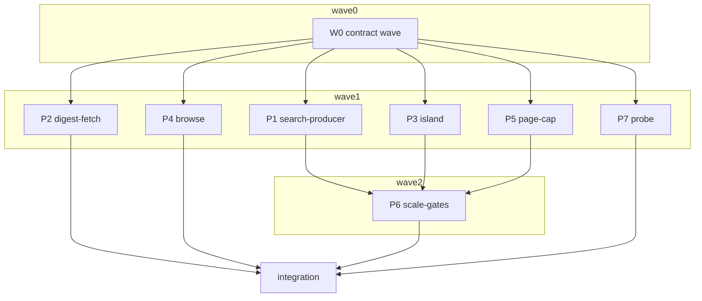

# Plan: index site at scale (P2b rows of the site ADR)

## Status
- State:   review
- Tier:    high
- Tier-grammar: 5
- Updated: 2026-10-23
- Next:    human review of the PR; V-19 dispatch before release (grimoire#218)

Resolves grimoire-rs/grimoire#217; carries the grimoire-rs/grimoire#218 dispatch job.
Source of truth (read-only): grimoire `origin/main:.agents/adr/adr_index_site_at_scale.md`
(S1–S5, Requirements, Validation) and `origin/main:.agents/specs/design_catalog_at_scale.md`
(§5.1 `c/root.json` `search` member, §5.8 retention, §5.9 log line, IX-R52).

## Classification

- Scope: medium (1–2 weeks). Reversibility: two-way (site pages, `c/q/` and blob placement are not
  contracts; `browse/` is already reserved by IX-R02 on the base branch).
- Tier: high (auto, confident: new `c/q` file and `browse/` pages, several areas, accepted ADR).
- Overlays: architect=inline (the ADR is the design), research=skip (ADR + three research
  artifacts), adversary=off at plan time (the code-diff adversary runs in `/hex-review`).
- Branch: `feat/site-at-scale`, on `main` after grimoire-rs/indexer#14.

## Requirement map (ADR row → contracts → pipeline)

| ADR row | Contracts | Pipeline |
|---|---|---|
| IX-R14, R37, R38 — 48-card `index.html`, flags, lazy search file and stats, mount rules | C-004, C-005, C-007 | P3 |
| IX-R15 — search file in every layout, gzip-only, magic-byte decode, stall failure, miss ladder | C-001, C-002, C-006 | W0, P1, P2, P3 |
| IX-R16 — `browse/<n>/`, one link per `/p/` page, sitemap without `c/`, sitemap index | C-008 | P4 |
| IX-R17, R46 — 24 KB page cap, staging bounds, structured previews, floor fixture | C-009, C-010, C-017 | P5 |
| IX-R24 — post-deploy `Content-Type` probe (warn-only) | C-015 | P7 |
| IX-R32 — gzip-only `c/q`, no sibling, deterministic gzip | C-002 | P1 |
| IX-R33 — Astro build settings and budgets | C-011, C-012, C-013 | W0, P6, integration |
| IX-R39 — theme-overlay carve-out | C-014, C-004 | W0, P3 |
| unnumbered — `force-cache`, one `reload` retry, `index.html` rung, `withBase` | C-006 | P2 |
| grimoire#218 — V-19 at 20,000 and 100,000 on a GitHub-hosted runner | C-013 | P6 |

Out of P2b scope (no requirement row): object-store publication past the ceiling (S2) and its
interleaved-deploy validation; trigger D's Pagefind switch (follow-up ADR); streaming and
virtualization (S4, deferred by the ADR itself).

## Decisions taken autonomously (recommended option, recorded)

| # | Question | Decision | Reason |
|---|---|---|---|
| D1 | The `prechange` golden pins `index.html`, `sitemap.xml`, the `_astro/Catalog.*`/`search.*` chunks and every `p/**` page, all of which IX-R14/R15/R16/R17 change | Integration narrows the golden with an explicit exemption map, each entry naming its ADR row: `index.html` (IX-R14), `sitemap.xml` (IX-R16), the island chunks (IX-R15), every `p/**` page's bytes (IX-R17/R46, D13) — whose path set stays asserted. `all.json`, `stats.json`, `robots.txt`, `favicon.svg`, `logo.svg` stay byte-pinned; contract:I1 additionally allows `browse/**` and renamed `_astro/**` chunks. The golden's `build()` passes `SiteFacts.search` to `publishDist` | The golden header calls a change a human decision, so the PR body states each exemption and its row |
| D2 | ADR S2: "staging works on a copy, never through the `enrich/` symlink", "at most two renders" | The cap runs on emitted HTML after the CSP post-process: pass 1 (changelog, then contents), pass 2 (README truncated at a block boundary), then the hard cut; a 5-minute budget, after which every remaining over-cap page takes the hard cut. Nothing under `enrich/` is written | One Astro pass instead of a second partial build; the cap is defined on emitted bytes; sanitized markdown panels carry no inline script or style, so CSP hashes are unchanged by a cut |
| D3 | Search file over the 32 MiB cap | No `c/q` file, `search: null`, an error-level `warn:` line naming trigger D; exit 0 | The browser decoder would abort past the cap anyway |
| D4 | S1 "stats load lazily, only for badges and for a rating or downloads sort" vs Validation "stats load only on a rating or downloads sort" | Stats never load at mount, nor on any interaction while no badge flag is set; with a flag set they load on a rating/downloads sort or when a row from the search file is rendered. The SSR 48 keep their badges from props | Keeps badges on search results; the validation line holds for an index without stats |
| D5 | Which restored state loads the search file on mount | URL `q`, `kind`, `kw`; stored `sort`, `dir`, `deprecated` different from the default. `view` and `density` do not | A table or density change needs no other rows |
| D6 | Units | KB/MB in the ADR are binary (24 KB = 24,576 B; 4 KB = 4,096 B; trigger D 6 MiB / 8 MiB); the host "1 GB" is decimal (trigger E at 800,000,000 bytes or 160,000 files) | Conservative for the host limit |
| D7 | Browse numbering and order | `browse/1/` … `browse/<max(1,⌈N/200⌉)>/`, `compare(a, b, 'name')` over every package including deprecated ones (marked) | One link per `/p/` page; a fixed `<noscript>` target |
| D8 | Probe shape; what "record" means | A `grim-indexer probe <site-url>` subcommand; "record" = the `c/f` blob the root names | Testable in vitest; templates stay one line |
| D9 | Interaction-trace budgets | Enforced on the 250-entry bulk site in `task quality:web`; report-only at 20,000 in the bench job | At 20,000 the measurement is the S4 virtualizer trigger, not a failure |
| D10 | How the bench checks the 4 KB bound | The bench builds a 100-entry baseline site in the same run; a vitest build test checks 100 vs 300 | The bound is a difference |
| D11 | Row order in the search file | The site's package order (the `all.json` order) | Deterministic; the island sorts anyway |
| D12 | Astro exact pin | `"astro": "7.4.2"` (the lock's resolved version), at integration with the lockfile | Hub files belong to no pipeline |
| D13 | The shipped template's chrome is already ~27.7 KB per page (two `is:inline` scripts in `Base.astro`, 8.3 KB + 9.3 KB, about half comments and indentation), so no page fits 24 KB and the C-010 floor cannot hold | Trim the per-page chrome without changing behaviour: comments leave the `is:inline` blocks (Astro `{/* */}` comments instead); every `window.__grim*` global stays defined in the head inline script; if the floor still exceeds 20 KiB, the body script's event wiring moves into one bundled Astro `<script>` (an `_astro/*.js` module, cached once). This changes every page's bytes (D1) | The ADR's floor assertion requires it, and 18 KB of duplicated script × 20,000 pages is ~0.36 GB of the 1 GB host budget the S2 table assumes is not there |
| D14 | `workflow_dispatch` only runs a workflow file that exists on the default branch | `bench.yml` triggers on `workflow_dispatch` only, one size per dispatch (default 10,000). The one-off 20,000 and 100,000 runs went through a scratch branch | Owner ruling: the bench is a manual tool, not a standing gate at 100,000 |
| D15 | `test/renderer/build.test.ts` (94 KB) is asserted on by P3, P4 and P5 changes | Hub file: no pipeline edits it; integration updates its broken asserts in one commit | Three concurrent pipelines cannot share it |
| D16 | P5.2 measured 32 older tags at ~60 KB and 32 plugin members at ~130 KB, so a 32-item preview alone can exceed 24 KB | Keep the ADR's 32-item previews; each structured section carries a link-out form `capPages` switches to without a re-render. Pass order: changelog, contents; then structured sections to link-out (largest first) while the page minus its README body is still over; then README truncation; then the hard cut (every panel and section in link-out form). The floor is the hard-cut page. `marketplace/**` pages stay outside the cap (C-009 covers `p/**`) | ADR S2 names both forms and asserts the floor only with every section in link-out form; the README survives a page whose only excess is a long tag list |
| D17 | The 20,000 bench measured the build at 15.3 GiB of RSS and 843 s (main: 5.2 GiB, 256 s) | Drop `deferRender` from every glob loader; keep `collectionStorage: "chunked"`. Measured at 20,000: 7.1 GiB, 282 s | `deferRender` makes each markdown file its own bundler module (native memory during "Building static entrypoints"); chunked costs about 2.1 GiB but a single `data-store.json` passes V8's string limit near 37,000 entries. Deviates from the ADR's IX-R33 settings; the 4 GiB budget is still missed at 20,000, as on main |
| D18 | Dev has no stats blob, so a windowed home page sorts ranked rows wrong in dev | `dev` renders every card inline (the pre-change behaviour) and publishes no search file | Dev previews themes; its page size is not a budget |
| D19 | Review: the cap's escaped output, `slimIcons` inside scripts, the probe's off-origin and host text | Bounds count escaped length; `slimIcons` rewrites only parse5-located `<svg>` start tags; the probe checks only URLs under the site's origin and base, sanitizes host text, and turns any throw into one warning | Round-1 review findings |
| D20 | The page cap's time budget makes the cut depend on machine speed | Kept: past the budget every remaining over-cap page takes the hard cut, reported as `pages_hard_cut` on the build line | D2's trade; a deterministic operation budget is a follow-up if the bench shows budget exhaustion |

## Component contracts

### C-001 — Search file format (`src/renderer/astro/lib/searchfile.ts`, shared by build and island)
- `SEARCH_SCHEMA = 1`; `SEARCH_CAP = 32 * 1024 * 1024` (inflated bytes);
  `SEARCH_FIELDS` = the 19 names in this order: `ref, kind, name, title, keywords, tags, summary,
  description, namespace, vendor, authors, license, compatibility, version, created, updated,
  deprecated, replacedBy, logo` (readonly tuple).
- `encodeSearchFile(packages: readonly Record<string, unknown>[]): string` returns
  `{"schema":1,"fields":[…19…],"rows":[[…],…]}` with no whitespace, rows in input order, every row
  exactly 19 cells in `SEARCH_FIELDS` order, `null` for an absent (`undefined`) field. Pure: no
  `node:` imports (the island imports this module).
- `decodeSearchFile(value: unknown): SearchRow[]` — `SearchRow` is a partial card record keyed by
  field name, a `null` cell becoming an absent key. Throws `SearchFileError` when `schema !== 1`,
  `fields` is not an array of strings containing all 19 names, `rows` is not an array, or any row
  is not an array of exactly `fields.length` cells. Extra field names are tolerated and ignored.
- Round trip: `decodeSearchFile(JSON.parse(encodeSearchFile(p)))` equals `p` projected onto the 19
  fields, for each field set and each field absent.

### C-002 — Producer (`src/renderer/site-search.ts`, `src/emit/root.ts`, `src/cli/{build,dev}.ts`)
- `prepareSiteSearch(outDir: string, packages: readonly CatalogPackage[], statsBytes: Uint8Array | null, siteMode: SiteMode): SiteDigests`,
  `SiteDigests = { search: BlobRef | null; stats: BlobRef | null }`.
  - Site serves packages: `bytes = encodeSearchFile(packages)` over the packages the site renders
    (after the renderer's transforms, so `logo` is the served path). Over `SEARCH_CAP` →
    `search: null` and one error-level `warn:` line naming trigger D (D3). Else writes
    `outDir/c/q/sha256/<sha256(bytes)>.json.gz` = `gzipDeterministic(bytes)` — no raw copy, no
    sibling — and returns `{sha256, size: bytes.length}`.
  - `stats` = `{sha256(statsBytes), size}` when non-null; it equals the `root.stats` ref
    `publishDist` writes in the same build. A stats-only change leaves `search` unchanged.
  - No packages served (`siteMode` marketplace-only) → `search: null`.
- `publishDist(dist, sync, handoff = null, now = new Date(), search: BlobRef | null = null)`;
  `PublishedInput.search?: BlobRef | null` (default `null`); `emitPublished` sets `root.search` and
  throws before writing the root when the named `c/q` file is absent (P-9). `build.ts` passes
  `SiteFacts.search`. Callers that pass nothing (conformance) get `search: null`; the conformance
  tree is unchanged. Holds in every layout × legacy combination.
- `dev`: `devSite` also calls `prepareSiteSearch` (W0 wiring) so the dev page names a served
  digest; `dev.ts` keeps `root.search` null (dev is never deployed).
- Retention needs no change (`rootFiles` lists `q`); after a rebuild with a changed catalog and a
  hand-off, the previous root's `q` file is in `dist/` byte-identical.

### C-003 — Build log line and site facts (`src/emit/logline.ts`; `SiteFacts` in `src/renderer/types.ts`)
- `buildSite` resolves to `SiteFacts = { search: BlobRef | null; stats: BlobRef | null; astroMs: number; astroDirBytes: number; pages: PageCapReport }`.
- The line gains, after the existing fields: `search=<sha256|none> search_wire=<gzip bytes|0>
  site_bytes=<sum of dist file bytes> site_files=<dist file count> astro_ms=<n>
  astro_dir_bytes=<n> pages_cut=<n> pages_hard_cut=<n>`. Log text, not a contract.
- Warnings (exit 0 always): trigger D — `search_wire ≥ 6 MiB` warn, `≥ 8 MiB` error-level;
  trigger E — `site_bytes ≥ 800,000,000` or `site_files ≥ 160,000`, error-level; one warn line per
  page in `pages.overCap`.

### C-004 — Landing page (`src/renderer/astro/pages/index.astro`; `GrimoireData` additions)
- `GrimoireData` gains `digests: { search: string | null; stats: string | null }` (hex) and
  `inlineCatalog: boolean`. Additive.
- Scale mode (`inlineCatalog === false`): the island receives `packages` = the first 48
  non-deprecated packages under `compare(a, b, 'name')` imported from `Catalog.tsx` (no second
  comparator) mapped through `cardPackage`, plus `total` (N), per-kind counts, `flags`
  (`hasDeprecated`, `hasRatings`, `hasDownloads`, `deprecated` count), `searchDigest`,
  `statsDigest`. No card props beyond the 48. A dedicated `
`
  carries `data-grim-search="<hex>"` and `data-grim-stats="<hex>"` (each omitted when null) for
  ladder rung 3. `<noscript>` keeps hiding `.catalog` and holds one paragraph linking
  `withBase('/browse/1/')` with N.
- `inlineCatalog === true`: today's markup (every card as props and the full `<noscript>` list).
- No new CSS in `Base.astro` or any stylesheet linked from `p/**` pages; new markup reuses existing
  classes or styles scoped to `index.astro`.
- `size(index.html at 300) − size(index.html at 100) ≤ 4,096` (vitest), and at 20,000 (bench).

### C-005 — Island load (`src/renderer/astro/components/Catalog.tsx`)
- Scale mode iff the `searchDigest` prop is present (string or `null`); otherwise full mode, which
  is today's behaviour (marketplace `searchUrl="/marketplace/all.json"`, a theme's `index.astro`
  passing every card) and still uses `loadSearchIndex` on a record array.
- Load triggers in scale mode: the first keystroke, a kind or keyword chip, a sort change, the
  deprecated toggle, the scroll sentinel past the 48, and on mount per D5. Exactly one load per
  page view.
- Before any load: the count reads "48 of N" (N following the deprecated filter, as today's count
  does). While a load is in flight (mount or user): the results keep the 48 as rendered,
  `aria-busy="true"`, the count reads "Loading N packages…"; the requested query, chip or sort
  applies once rows arrive — never a sort over a partial set.
- After the load: rows from `decodeSearchFile` replace the 48; `kw` from the URL is validated
  against the loaded rows' keywords, so `replaceState` never erases a deep link before the load.
- `searchDigest === null` or `DigestLadderError`: substring search over the server-rendered cards,
  a visible notice, and a link to `withBase('/browse/1/')`. Never `/all.json`.

### C-006 — Digest fetch and miss ladder (`src/renderer/astro/lib/digestfetch.ts`)
- `fetchJson(url: string, opts: { cap: number; stallMs?: number; cache: RequestCache; signal?: AbortSignal }): Promise<unknown>`:
  `fetch(url, { cache })`; non-ok throws; the body is read chunk by chunk and aborts when no chunk
  arrives for `stallMs` (default 15 s — a stall fails the load, a slow steady body finishes);
  bytes starting `1f 8b` go through `DecompressionStream('gzip')`, anything else is parsed as it is
  (host-decoded); inflated bytes past `cap` abort; returns `JSON.parse` of the text.
- `loadDigest<T>(kind: 'q' | 'f', digest: string, opts: { cap: number; decode: (v: unknown) => T; attr: 'search' | 'stats' }): Promise<T>`:
  rung 1 `withBase('/c/<kind>/sha256/<d>.json.gz')` with `cache: 'force-cache'`; any failure
  (network, status, stall, cap, gzip, `decode` throwing) → rung 2 the same URL with
  `cache: 'reload'`; failure → rung 3 `fetch(withBase('/'), { cache: 'reload' })`, read
  `data-grim-<attr>="<64 hex>"`, fetch that digest (`force-cache`, or `reload` if unchanged);
  failure → throws `DigestLadderError`. Every URL through `withBase`; `/all.json` never requested.
- Search cap `SEARCH_CAP`; stats cap 128 MiB.

### C-007 — Stats (island)
- The stats blob loads through `loadDigest('f', statsDigest, …)` only under D4. It joins
  `entries[ref].rating.up` (+ `url`) and `entries[ref].downloads.total` onto rows, the projection
  `withRatings`/`withDownloads` apply at build. A failure leaves badges absent and a rating or
  downloads sort ordering nulls last; nothing throws to the page.

### C-008 — Browse pages and sitemap (`pages/browse/[n].astro`, `src/renderer/astro/lib/browse.ts`, `src/renderer/sitemap.ts`)
- `browsePages(packages, size = 200)` (pure) pages every package in `compare(a, b, 'name')` order.
- `browse/<n>/` per D7: each a list linking `/p/<ns>/<name>/` through `withBase` (deprecated
  marked), previous/next links, no client JS, the shipped `Base` layout (CSP post-process applies).
  Every `/p/` page linked exactly once across pages. Emitted only when the site serves packages.
- `sitemap.xml` lists `/`, `marketplace/` (when served), every `browse/<n>/`, every `/p/` page and
  every marketplace page; never a `c/` path. More than 50,000 URLs → `sitemap.xml` is a
  `<sitemapindex>` naming `sitemap-1.xml`, `sitemap-2.xml`, … of ≤ 50,000 URLs each. `robots.txt`
  unchanged.

### C-009 — Page cap pass (`src/renderer/pagecap.ts`)
- `capPages(outDir: string, packages: readonly CatalogPackage[], opts?: { cap?: number; budgetMs?: number; now?: () => number }): Promise<PageCapReport>`
  over `outDir/p/<ns>/<name>/index.html` for each package, after `postProcessSite`. Defaults
  `cap = 24,576`, `budgetMs = 300,000`. `PageCapReport = { cut: number; hardCut: number; overCap: string[] }`.
- A page ≤ cap is never rewritten. Over cap: pass 1 empties the changelog panel, then if still
  over the contents panel, each replaced by `
` naming the
  record's `repository` (a link, when present) and the `grim fetch <ref> --description` command;
  pass 2 truncates the README panel at a top-level block boundary to fit and appends
  `
` with the same link-out; still over → the hard cut
  (every markdown panel replaced by the link-out and the truncated notice). Once `budgetMs` is
  spent, every remaining over-cap page takes the hard cut; `budgetMs = 0` still deploys. A page
  still over after the hard cut is listed in `overCap`; the build exits 0.
- Inserted markup: no inline style, no inline script, existing classes only (the implementer
  confirms `.empty` or picks another existing class and updates this line). Nothing under `enrich/`
  is read or written (D2).

### C-010 — Structured-section bounds (`PackageDetail.astro`, markup only)
- Bundle members and plugin members: first 32, then "N more" with a link-out; the MCP descriptor
  JSON: pretty JSON cut at a line boundary within 2 KiB, then a link-out; older tags: 32, then a
  link-out; download rows: 32; the summary line: 1 KiB, cut at a code-point boundary with an
  ellipsis; any other record field shown on the page that the floor needs bounded likewise. Each
  link-out names a grim command that exists at grim main (checked with
  `git -C /home/mherwig/dev/grimoire/.agents/worktrees/docs-227 show origin/main:src/command/<cmd>.rs`).
- No edit to `PackageDetail.astro`'s `<style>` block (its CSS chunk is linked from every page).
- Floor: a record with every field at its emit bound (`src/emit/records.ts`: 16 KiB description,
  128 tags, 32 keywords, 16 authors; 5,000 bundle members; an MCP descriptor at the 1 MiB ingest
  cap) and every section in link-out form renders ≤ 24,576 B after the CSP post-process.

### C-011 — Astro settings (`src/renderer/index.ts`, `src/renderer/astro/content.config.ts`)
- Every glob loader sets `deferRender: true`; `inlineConfig` sets
  `experimental: { collectionStorage: 'chunked' }`. A unit test asserts both settings.

### C-012 — Build measurements (`src/renderer/index.ts`)
- `astroMs` = wall time of `build(astro)`; `astroDirBytes` = bytes under the staged `.astro/`
  measured before the staged dir is removed (0 when absent). A build test asserts both are > 0.

### C-013 — V-19 bench and job (`scripts/bench-scale.mjs`, `.github/workflows/bench.yml`)
- New checks (PASS/FAIL, in `checks[]` of the `--json` report): every dist file ≤ 16 MiB except
  the P-10 exemptions plus `c/q/*`; every `p/**/index.html` ≤ 24,576; `index.html` growth vs a
  100-entry baseline build ≤ 4,096 (D10); peak RSS of either build step ≤ 4 GiB;
  `astro_dir_bytes` ≤ 2 GiB; `astro_ms` ≤ 15 min. Report adds `index_html_bytes`,
  `index_html_baseline_bytes`, `largest_file {path, bytes}`, `largest_page {path, bytes}`,
  `peak_rss_mib`, `astro_ms`, `astro_dir_bytes`. Exit 0 / 1 / 64 as today.
- `bench.yml` per D14: triggers `workflow_dispatch` only, input `entries` (default 10,000),
  `ubuntu-latest`, `timeout-minutes: 180`; top-level `permissions: {}` and
  `contents: read` per job; every `uses:` pinned to a 40-hex SHA; `persist-credentials: false`; no
  npm cache; ocx + node 24 as `ci.yml` does; runs `npm run bench:scale -- --entries N --json`
  writing `bench-N.json` (stdout) and `bench-N.txt` (stderr); uploads both with `if: always()`;
  every run also runs C-016 report-only. actionlint and zizmor clean.

### C-014 — Theme-overlay carve-out (`src/renderer/index.ts`)
- When either overlay layer replaces `components/Catalog.tsx` or `pages/index.astro`,
  `GrimoireData.inlineCatalog = true` and one extra stderr line follows that layer's replaced-path
  line: `<label>/<rel>: the home page inlines every card while this file is replaced`. Otherwise
  `false`. `data.packages` stays whole.

### C-015 — Post-deploy probe (`src/cli/probe.ts`, `src/ci.ts`, `templates/ci/*`)
- `grim-indexer probe <site-url>`: GETs `c/root.json` (expects `application/json`), the `c/f`
  blob its `stats` or `flat` member names (expects `application/gzip`, `application/x-gzip`, or
  `application/json` with `Content-Encoding: gzip`), and — through the search file's rows — one
  logo (`image/png|jpeg|webp|gif`, matching its extension) and one `/p/` page (`text/html`). Each
  mismatch, network error or missing input is one `warn:` line; exit 0 always, 64 on usage.
  Redirects off the site origin are not followed; bodies capped. A root naming neither `stats` nor
  `flat` has no blob to check and is skipped. Only URLs under the site's origin and base are fetched.
- Rendered CI: the GitHub `pages` workflow gains a `probe` job (`needs: deploy`,
  `continue-on-error: true`, `permissions: contents: read`, `cache-mode: none`, no `cache: npm`,
  checkout + setup-node + `npm ci --ignore-scripts`, pinned actions); GitLab gains a `probe` job in
  the existing `deploy` stage (`needs: [pages]`, `allow_failure: true`, `cache: []`). No new stage.

### C-016 — Interaction trace (`scripts/quality-interaction.mjs`, `taskfile.yml`)
- Serves a built site on loopback, drives `/` in headless Chrome (`puppeteer-core`, `CHROME_PATH`)
  at 4× CPU throttle: scroll to the end, change the sort, type a query; records long tasks and the
  DOM node count. `--budget` fails on a breach (task `quality:web`, 250-entry bulk site);
  `--report` prints JSON only. A pure `evaluateBudgets(measure, budgets)` is unit-tested, with a
  planted-breach control proving `--budget` exits non-zero.

### C-017 — Chrome trim (`src/renderer/astro/layouts/Base.astro`, scripts only) — D13
- Behaviour unchanged: the same globals, listeners and pre-paint effects, verified by the existing
  build/hydrate/CSP tests and `scripts/quality-csp.mjs`. No edit to the `<style is:global>` block.
  The minimal-page floor (the renderer fixture's `tool-guard` page) drops below 20 KiB.
- Review amendment: one `:where(svg.lucide)` rule joins `@layer grimoire` so the cap can drop the
  attributes every icon repeats on an over-cap page; `docs/reference/theme-overlay.md` states it.

## User-experience scenarios

| ID | Action → outcome; error case | Test steps |
|---|---|---|
| S-001 | First visit at N entries: 48 cards, "48 of N", chips per flags, no `c/q` request. | P3.1, P3.2 |
| S-002 | First keystroke: one `c/q` request, results over all N. Error: stale digest → `reload` retry → `index.html` rung → substring over the 48 with a notice and a `browse/1/` link. | P2.2, P3.3 |
| S-003 | Deep link `/?kw=…&kind=…`: pending, load on mount, `kw` survives. Error: load fails → notice, URL keeps `kw`. | P3.3 |
| S-004 | Rating sort: stats and search file load once each, nulls last. Error: stats fail → no badges, sort still completes. | P3.4 |
| S-005 | No JavaScript: `<noscript>` link → `browse/1/` with 200 packages and next/previous links. | P3.1, P4.1 |
| S-006 | Crawler: sitemap names every `browse/` and `/p/` page, never `c/`; a sitemap index past 50,000 URLs. | P4.2 |
| S-007 | Huge README: changelog/contents link out first, then a truncated README with the notice. | P5.3, P5.4 |
| S-008 | Theme replaces `Catalog.tsx`: one warning per replaced file; `/` inlines every card. | W0.2, P3.1 |
| S-009 | Build log: `search_wire`, `site_bytes`, `site_files`; trigger D/E warnings; exit 0. | P1.3 |
| S-010 | Deploy probe: a wrong `Content-Type` is a warning; the job stays green. | P7.1, P7.2 |
| S-011 | Maintainer dispatches the V-19 job: one report per entry count. | P6.1, P6.2 |

## Backwards compatibility (Principle 9)

- Default config (`layout: flat`, `legacy: true`): `/all.json`, `/stats.json`, their `.gz`
  siblings, the `c/f` blobs, `robots.txt`, `favicon.svg`, `logo.svg` stay byte-identical; every
  `/p/<ns>/<name>/` URL stays (the golden keeps pinning them).
- Changed by ADR rows (each stated in the PR body): `index.html` (IX-R14), the island chunks
  (IX-R15), `sitemap.xml` and new `browse/**` (IX-R16), every `/p/` page's bytes — trimmed chrome,
  bounded sections, and cuts for pages over 24 KB (IX-R17/R46, D13) — new `c/q/**` and a non-null
  `root.search` (IX-R15/R32; grim never types `search`, design §5.1), a rendered CI probe job
  (IX-R24; existing index repos re-render with `npm run ci`, as for every template change).
- grim 0.14.3 reads `/all.json` (unchanged); grim at main reads `c/root.json` and ignores
  `search`; `npm run conformance:check` stays green (the generator passes no search ref).
- No new exit code: `probe` uses 0 and 64; every new warning keeps the build at exit 0.
- `loadSearchIndex` still accepts a record array (marketplace, themes).

## JSON interfaces

- `c/q/sha256/<d>.json.gz` (C-001) — site-private, versioned by `schema`.
- `GrimoireData` additive fields (C-004).
- Bench `--json` report: additive fields (C-013), `v: 1` unchanged.
- The build log line stays log text (C-003).

## Test strategy (TDD inside each step)

Each step writes its failing test first, then the code, and runs only the tests it touched:
`npx vitest run <paths>` selecting at least one test. Any test that builds a site (Astro) runs
under `flock /home/mherwig/dev/grimoire/.agents/cargo-build.lock`. The golden,
`test/renderer/build.test.ts` (D15), conformance, `task check` and the 20,000 bench are
integration-gate only.

## Contract wave (W0, on `feat/site-at-scale`, before any pipeline)

1. **W0.1 — shared surface.** `src/renderer/astro/lib/searchfile.ts` (C-001, implemented in full:
   it is the format) with `test/renderer/searchfile.test.ts`; `SiteFacts`, `SiteDigests`,
   `PageCapReport` and the `GrimoireData` additions in `src/renderer/types.ts`; stubs
   `src/renderer/site-search.ts` (`prepareSiteSearch` → `{search: null, stats: null}`),
   `src/renderer/pagecap.ts` (`capPages` → zeros), `src/renderer/astro/lib/digestfetch.ts`
   (signatures, `DigestLadderError`, bodies throwing `not implemented`); move `writeSitemap` from
   `src/renderer/index.ts` to `src/renderer/sitemap.ts` unchanged; wire `buildSite` and `devSite`
   to call `prepareSiteSearch` before staging and put `digests`/`inlineCatalog: false` into
   `__GRIMOIRE_DATA__`; `buildSite` calls `capPages` after `postProcessSite`, measures C-012 and
   returns `SiteFacts` (test: a fixture build returns `astroMs > 0`, `astroDirBytes > 0`).
2. **W0.2 — overlay and Astro settings.** C-014 detection, flag and warning line with a test in
   `test/renderer/overlay.test.ts`; C-011 settings with a unit test;
   `docs/reference/theme-overlay.md` carve-out paragraph. Check: `npm run typecheck`, the touched
   tests; the orchestrator runs the golden under the lock and requires it still green.

## Parallelization

| Pipeline | Scope | Expected Files | Wave | Depends on | Marks | Status |
|---|---|---|---|---|---|---|
| P1 search-producer | C-002, C-003; IX-R15 (producer), IX-R32; S-009 | `src/renderer/site-search.ts`, `src/emit/root.ts`, `src/emit/logline.ts`, `src/cli/build.ts`, `src/cli/dev.ts`, `docs/reference/output-layout.md`, `test/renderer/site-search.test.ts`, `test/emit/root.test.ts`, `test/emit/logline.test.ts`, `test/cli/build.test.ts`, `test/cli/dev_handoff.test.ts`, `test/state/retention.test.ts` | 1 | W0 | | pending |
| P2 digest-fetch | C-006; cache row; S-002 | `src/renderer/astro/lib/digestfetch.ts`, `test/renderer/digestfetch.test.ts` | 1 | W0 | | pending |
| P3 island | C-004, C-005, C-007; IX-R14, R37, R38, R39 (consumer); S-001…S-005, S-008 | `src/renderer/astro/pages/index.astro`, `src/renderer/astro/components/Catalog.tsx`, `src/renderer/astro/lib/search.ts`, `test/renderer/index-page.test.ts`, `test/renderer/catalog-scale.test.tsx`, `test/renderer/hydrate.test.tsx`, `test/renderer/sort.test.ts`, `test/renderer/search.test.ts` | 1 | W0 | review | pending |
| P4 browse | C-008; IX-R16; S-005, S-006 | `src/renderer/astro/pages/browse/[n].astro`, `src/renderer/astro/lib/browse.ts`, `src/renderer/sitemap.ts`, `test/renderer/browse.test.ts`, `test/renderer/sitemap.test.ts`; `docs/reference/output-layout.md` only after P1 merged | 1 | W0 | | pending |
| P5 page-cap | C-009, C-010, C-017; IX-R17, R46; S-007 | `src/renderer/astro/layouts/Base.astro` (scripts only), `test/renderer/layout_scripts.test.ts`, `src/renderer/pagecap.ts`, `src/renderer/astro/components/PackageDetail.astro` (markup only), `test/renderer/pagecap.test.ts`, `test/renderer/detail-bounds.test.ts`, `test/renderer/chrome.test.ts`, `test/renderer/fixture-floor/**` | 1 | W0 | hard | pending |
| P6 scale-gates | C-013, C-016; IX-R33 budgets; grimoire#218; S-011 | `scripts/bench-scale.mjs`, `scripts/lib/**`, `.github/workflows/bench.yml`, `scripts/quality-interaction.mjs`, `taskfile.yml`, `test/bench/scale.test.ts`, `test/scripts/quality-interaction.test.ts` | 2 | P1, P3, P5 | | pending |
| P7 probe | C-015; IX-R24; S-010 | `src/cli/probe.ts`, `src/cli/main.ts`, `src/ci.ts`, `templates/ci/**`, `test/cli/probe.test.ts`, `test/cli/ci.test.ts`, `test/cli/ci-state.test.ts`, `test/cli/ci-cache.test.ts`, `docs/reference/cli.md`, and the docs page that documents the rendered CI (the step names it) | 1 | W0 | | pending |

Hub files (no pipeline; integration only): `package.json`, `package-lock.json`,
`test/data/prechange.test.ts`, `test/data/golden/**`, `test/renderer/build.test.ts`,
`docs/ops/upgrade-notes.md`. `docs/reference/output-layout.md` is P1's, then P4's last step after
P1 merges.

- Critical path: W0 → P3 (4 steps) → P6 (3 steps) → integration.
- Shippable after wave: 1 — the 48-card page, search file, browse pages, page cap and probe; wave 2
  adds the scale gates and the bench job.
- Six wave-1 pipelines run at most four at a time: the host is RAM-bound and every Astro build
  takes the shared lock, so more concurrency only queues on it.

## Implementation steps

### P1 search-producer
1. `prepareSiteSearch` (C-002) with `test/renderer/site-search.test.ts`: the written file gunzips
   to bytes whose sha256/size equal the ref; no raw `.json` and no sibling is written; two calls
   give identical gzip bytes; over-cap → `null` plus the trigger-D line; marketplace-only → `null`;
   the stats ref equals `sha256(statsBytes)`; a stats-only change leaves `search` unchanged.
2. `emitPublished`/`publishDist` `search` and the P-9 check; `build.ts` passes it; `dev.ts` keeps
   null. Tests: `test/emit/root.test.ts` (root names the ref; missing file throws before the root
   is written; no ref → `null`; all four layout × legacy combinations); `test/cli/build.test.ts`
   (a CLI build's root names a `c/q` file that exists and verifies; a rebuild with a changed
   catalog and a hand-off keeps the previous `q` byte-identical); `test/cli/dev_handoff.test.ts`
   (dev root `search` null).
3. Log line fields and triggers D/E (C-003) with `test/emit/logline.test.ts`; document `c/q` and the
   `search` member in `docs/reference/output-layout.md`.

### P2 digest-fetch
1. `fetchJson` (C-006) with `test/renderer/digestfetch.test.ts` on a mocked `fetch` and
   `ReadableStream`s: gzip decoded; host-decoded parsed; cap aborts; a stalled body fails after
   `stallMs` while a slow steady body finishes past it; non-ok throws.
2. `loadDigest` ladder: rung 1 `force-cache`; a cached 404 recovers on the `reload` retry; a
   decode rejection takes the ladder; rung 3 reads the fresh digest from `index.html`; exhaustion
   throws `DigestLadderError`; URLs carry the base path under a sub-path base; `/all.json` is never
   requested.

### P3 island (mark: review)
1. `index.astro` scale and inline branches (C-004) and the additive `Catalog` props;
   `test/renderer/index-page.test.ts` (builds under the lock): over 120 synthetic packages the
   island props hold exactly the first 48 non-deprecated by name, flags/counts/N and the
   `#grim-digests` attributes equal `SiteFacts`, `<noscript>` links `browse/1/` (also under a
   sub-path `site`); with `inlineCatalog` every card is inlined and the full `<noscript>` list
   returns; `size(index.html at 300) − size(at 100) ≤ 4,096`.
2. Catalog load triggers, latch and counts (C-005) with `test/renderer/catalog-scale.test.tsx`
   (jsdom, mocked `loadDigest`): each user trigger loads once; "48 of N" before, full counts after;
   in-flight state per C-005.
3. Mount-time loads and failure (C-005): URL `q`/`kind`/`kw` and stored `sort`/`dir`/`deprecated`
   load on mount, `view`/`density` do not; the `kw` deep link survives; fallback notice + `browse/1/`
   on `DigestLadderError` and on `searchDigest === null`; full mode unchanged (existing
   `hydrate`/`sort`/`search` tests green; `loadSearchIndex` accepts a record array).
4. Stats lazily (C-007, D4): no stats request at mount or on a keystroke; a rating/downloads sort
   loads it once; a rendered search-file row with a flag set loads it; failure leaves badges
   absent.

### P4 browse
1. `lib/browse.ts` and `pages/browse/[n].astro` with `test/renderer/browse.test.ts`: paging at
   N = 0, 200, 201, 450; a build (under the lock) where every `/p/` link appears exactly once,
   deprecated packages are marked, pages carry the CSP meta and no client script.
2. `sitemap.ts` (C-008) with `test/renderer/sitemap.test.ts`, a pure test at 100,500 URLs: index
   shape, ≤ 50,000 per file, no `c/` path, browse pages listed.
3. After P1 merged: `browse/` and sitemap paragraphs in `docs/reference/output-layout.md`.

### P5 page-cap (mark: hard)
1. Chrome trim (C-017, D13) with `test/renderer/chrome.test.ts`: the fixture's `tool-guard` page
   < 20 KiB; every global and listener still present (assert by the existing build tests the
   orchestrator runs, plus a jsdom smoke of the trimmed scripts); `scripts/quality-csp.mjs`
   semantics unchanged.
2. Structured bounds part 1 (C-010): members/plugin members, older tags, download rows, summary
   line, with fixtures under `test/renderer/fixture-floor/` and
   `test/renderer/detail-bounds.test.ts` (build under the lock).
3. Structured bounds part 2: the MCP descriptor cut and the worst-case floor record; each fixture
   page ≤ 24,576 after the post-process.
4. `capPages` (C-009) with `test/renderer/pagecap.test.ts`: synthetic pages exercise each pass in
   order, the notices (`data-grim-cut`), the budget (injected clock), `budgetMs = 0`; a page ≤ cap
   untouched; an over-cap theme page reported; one build with a 200 KiB README fixture ends
   ≤ 24,576 with the truncated notice.

### P6 scale-gates (wave 2)
1. Bench checks and report fields (C-013) and the 100-entry baseline; `test/bench/scale.test.ts`
   (30 entries) asserts the new check names appear and pass.
2. `.github/workflows/bench.yml` (C-013, D14); actionlint and zizmor through ocx or the
   `task lint:actions` / `task lint:workflows` targets.
3. `scripts/quality-interaction.mjs` (C-016) with `test/scripts/quality-interaction.test.ts`
   (budget evaluator + planted breach); `task quality:web` wiring with budgets measured on the 250
   bulk site (2× headroom, recorded in the script header); the report-only step in the job.

### P7 probe
1. `src/cli/probe.ts` and its registration, with `test/cli/probe.test.ts` (loopback server): right
   types → no warning; each wrong type → one warning; unreachable → warning; exit 0; usage → 64;
   `docs/reference/cli.md` entry.
2. Rendered CI jobs (C-015) and `test/cli/ci.test.ts`, `ci-cache.test.ts`, `ci-state.test.ts`
   updates (permissions present, pinned `uses:`, cache scoping, GitLab stages unchanged,
   deterministic re-render); the CI docs page.

### Integration (orchestrator, on `feat/site-at-scale`)
1. Pin `"astro": "7.4.2"` with `npm install --package-lock-only` (no other upgrade).
2. Golden per D1; `test/renderer/build.test.ts` asserts per D15; `docs/ops/upgrade-notes.md`
   (re-render CI for the probe job; `browse/` and `c/q/`; page cap).
3. A CLI build test that the page's `data-grim-search` equals `root.search.sha256`.
4. Gates: `task check`, `test/data/prechange.test.ts`,
   `GRIM_CHECKOUT=/home/mherwig/dev/grimoire/.agents/worktrees/docs-227 npm run conformance:check`,
   `npm run bench:scale -- --entries 20000` (all under the lock).

## Open questions

None open: D1–D20 record the recommended answers.

## Schedule log
- 2026-10-22T21:31:54Z · step W0/1 · model standard · work ~4m
- 2026-10-22T21:31:54Z · step W0/2 · model standard · work ~4m
- 2026-10-22T21:41:23Z · merged P2 @ f409aad · ready: P4, P7 · blocked: P6 (P1, P3, P5)
- 2026-10-22T21:59:06Z · P1.2 9e3b037, P3.2 585fceb, P4.1 524c0bc, P5.2 f17674f landed in pipeline branches · dispatched P1.3, P3.3+P3.4, P4.2, P5.3+P5.4 · D16 recorded
